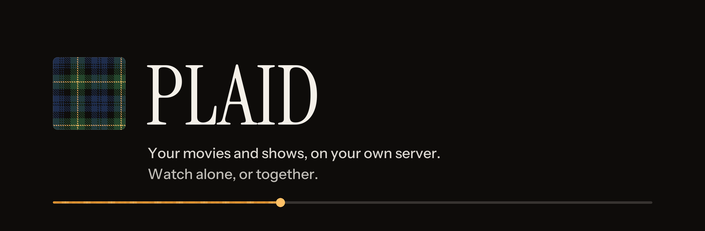
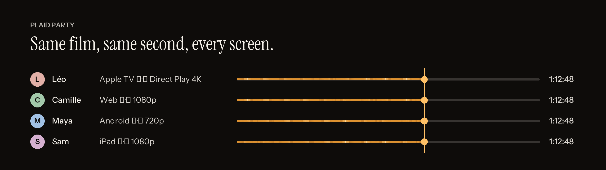
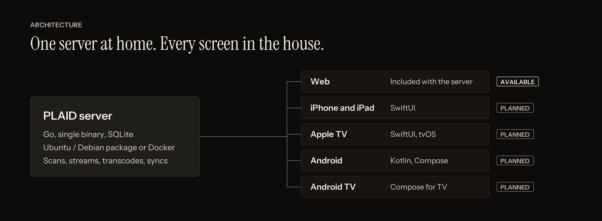

<p align="center">
  
</p>

<p align="center">
  <a href="https://github.com/gh-prim/plaid/actions/workflows/ci.yml"></a>
  <a href="https://github.com/gh-prim/plaid/actions/workflows/release.yml"></a>
  <a href="LICENSE"></a>
</p>

PLAID is a self-hosted media server, an open alternative to Plex. It indexes the movies and shows on your disks and streams them to every screen in the house. Watching together, in the same room or miles apart, is built in rather than bolted on.

> **Status: early development.** The server, its web app and the install packages are in place. Libraries, playback and the TV apps are next. Nothing to watch yet.

## Watch together



A **Plaid Party** keeps everyone on the same frame. The server holds the clock, every participant gets a stream suited to their device and connection (4K Direct Play on the living room TV, 720p on a phone on the train), and play, pause and seek stay in sync. Reactions, chat and pause requests come with it.

## One server, every screen



| Surface | Stack | Status |
|---|---|---|
| Server | Go, single binary, SQLite, FFmpeg | In progress |
| Web | React, served by the server | In progress |
| iPhone, iPad, Apple TV | SwiftUI, one codebase | Planned |
| Android, Android TV | Kotlin, Jetpack Compose | Planned |

## Roadmap

| Feature | Status |
|---|---|
| Foundations: API contract, CI, Docker, Ubuntu/Debian package | Done |
| Design system | In progress |
| Accounts and profiles | Next |
| Libraries: scanning, matching, metadata and artwork | Next |
| Playback: Direct Play, remux, hardware transcoding | Next |
| Web: browsing, search, player | Planned |
| Library sharing with friends | Planned |
| Plaid Party | Planned |
| Apple and Android apps | Planned |

The full list, with the intent and spec behind each feature, lives in [sdlc/roadmap.md](sdlc/roadmap.md).

## Install

PLAID runs on Ubuntu 24.04 and 26.04, Debian 12 and later, on `amd64` and `arm64` (for example a Raspberry Pi 4 or 5 with a 64-bit OS).

**Ubuntu or Debian, no Docker needed.** Installs a system service that starts on boot:

```bash
curl -fsSL https://raw.githubusercontent.com/gh-prim/plaid/main/packaging/install.sh | sudo bash
```

**Docker:**

```bash
git clone https://github.com/gh-prim/plaid.git && cd plaid
docker compose up -d
```

Then open `http://<your-server>:32500`. Manual `.deb` install, configuration, upgrades and media folder permissions: [docs/install.md](docs/install.md).

## Develop

You need Go 1.26, Node 24, pnpm 10, golangci-lint and shellcheck. Docker for images and package tests.

```bash
make setup   # install dependencies
make dev     # server on :32500, web dev server on :5173
make test    # everything CI checks
```

Every other command, and what success looks like: [CLAUDE.md](CLAUDE.md#commands).

### How we work

No code without a plan. Each feature goes `intent.md` → `spec.md` → `plan.md` → code, and each step is a reviewed file in [`sdlc/`](sdlc/README.md). The API is described once in [`api/openapi.yaml`](api/openapi.yaml), and the Go server and every client are generated from it. All text in the apps goes through i18n: English first, French next.

## Design

The interface is the dark room around the screen: warm near-black neutrals, quiet type ([Instrument Sans](https://fonts.google.com/specimen/Instrument+Sans) and [Instrument Serif](https://fonts.google.com/specimen/Instrument+Serif)), and a single warm color, the amber thread, for focus, progress and the one primary action. It comes from the yellow over-check of the registered Gordon tartan, which appears woven thread by thread in the logo and in the played part of the timeline, and nowhere else. The posters bring the color.

## License

[MIT](LICENSE).
