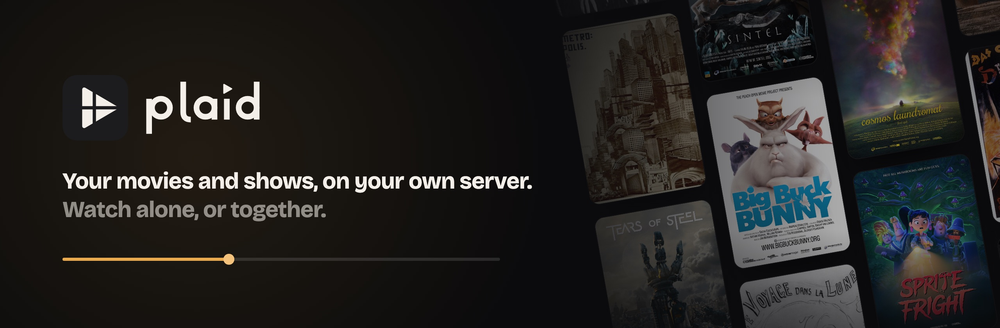
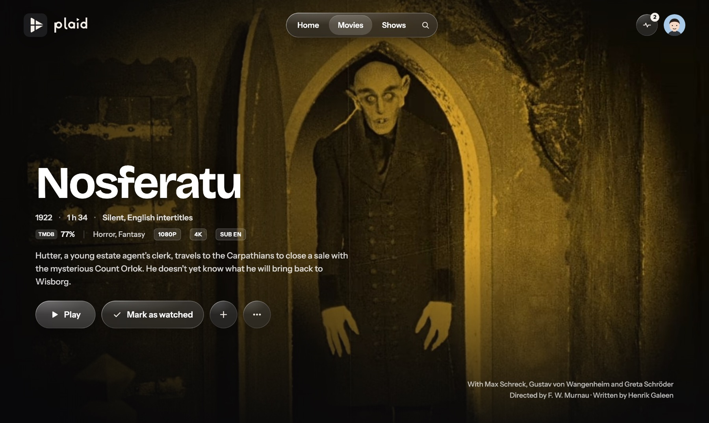
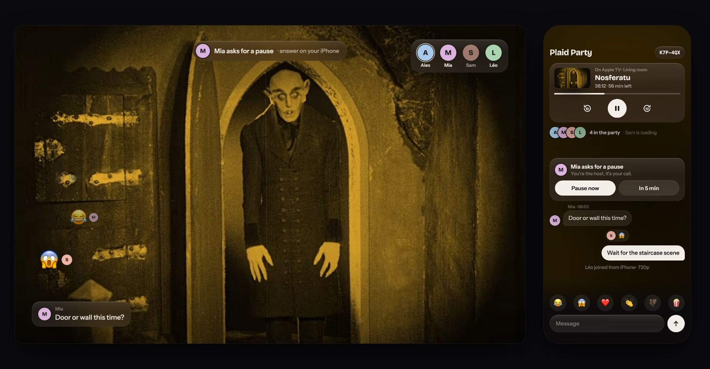
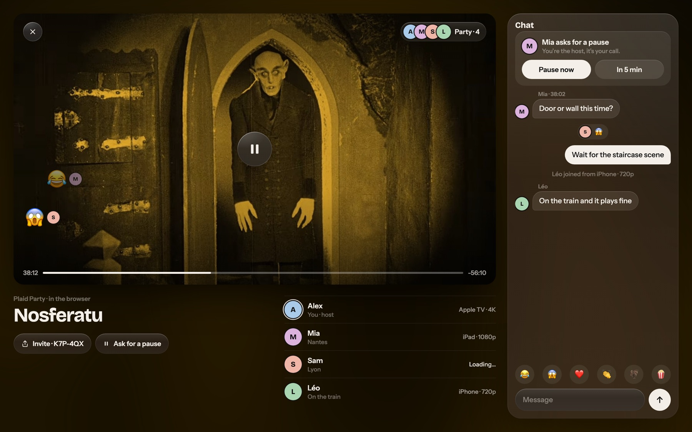
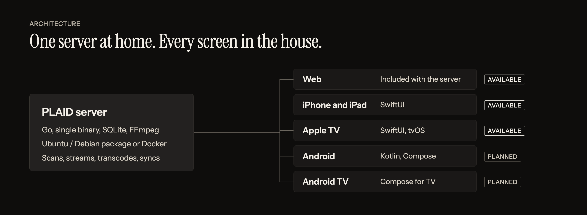
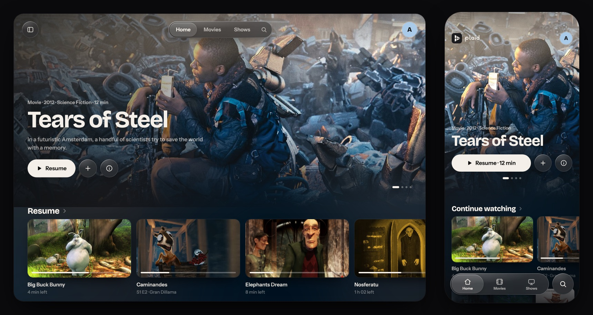
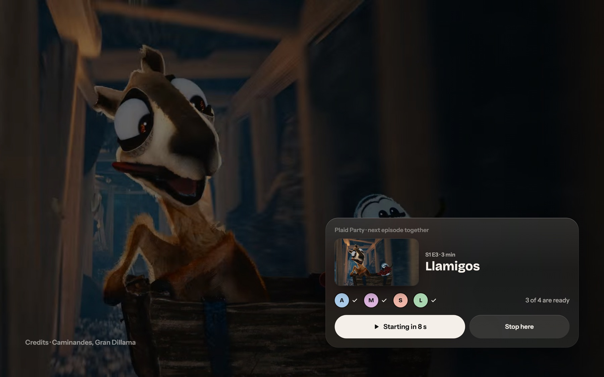
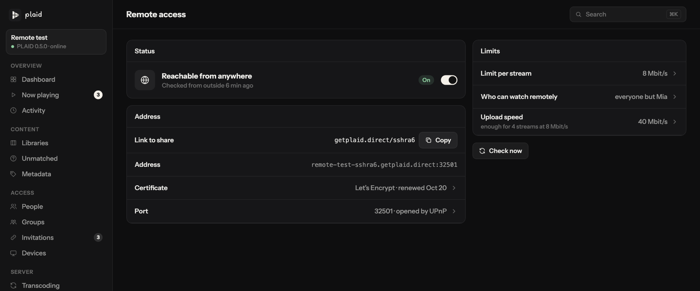

<p align="center">
  
</p>

<p align="center">
  <a href="https://github.com/gh-prim/plaid/actions/workflows/ci.yml"></a>
  <a href="https://github.com/gh-prim/plaid/actions/workflows/release.yml"></a>
  <a href="LICENSE"></a>
</p>

PLAID is a self-hosted media server, an open alternative to Plex. It indexes the movies and shows on your disks and streams them to every screen in the house. Watching together, in the same room or miles apart, is built in rather than bolted on.

> **Status: early, but you can watch.** The server scans your libraries, fetches metadata and artwork, and plays everything in the browser, on iPhone, iPad and Apple TV, at home or from anywhere. Plaid Party, watching together, landed in v0.5. Android is next. Expect rough edges and breaking changes before 1.0.
>
> The screens below come from the design files the apps are built from, shown with public-domain and Creative Commons films.

<p align="center">
  
</p>

## What it does

- **Libraries that look after themselves.** Point PLAID at your folders. It scans them, matches each file on TMDB, pulls posters, backdrops and logos from TMDB and fanart.tv, and keeps up as files come and go. Anything it can't match waits in a list for you.
- **Plays anything, the lightest way.** Direct Play when the device can take the file as is, an HLS remux when only the container is wrong, a transcode when it has to: on the GPU (VAAPI, Quick Sync, NVENC, Raspberry Pi V4L2) or in software, with HDR tone mapping. Seeking never waits for the transcode to catch up.
- **Every screen.** A web app served by the server itself, plus native iPhone, iPad and Apple TV apps. Pair a TV by typing the code it shows.
- **From anywhere, without a cloud account.** Turn on remote access and PLAID opens a port on your router (NAT-PMP or UPnP), gets its own `getplaid.direct` name and a Let's Encrypt certificate. getplaid.direct only finds your server: your video never goes through it.
- **For the whole household.** Profiles with PINs and age limits, invitations, groups and per-library sharing, and an admin that tells you what's playing and what needs you.

## Watch together



A **Plaid Party** keeps everyone on the same frame. The server holds the clock, every participant gets a stream suited to their device and connection (4K Direct Play on the living room TV, 720p on a phone on the train), and play, pause and seek stay in sync. Chat, reactions and pause requests come with it, on the big screen and on the phone in your hand.



Friends without a PLAID account can join from a link in their browser.

## One server, every screen







| Surface | Stack | Status |
|---|---|---|
| Server | Go, single binary, SQLite, FFmpeg | Available |
| Web | React, served by the server | Available |
| iPhone, iPad, Apple TV | SwiftUI, one codebase | Available, build with Xcode (not on the App Store yet) |
| Android, Android TV | Kotlin, Jetpack Compose | Planned |

## Run it yourself, reach it from anywhere



Everything runs on your machine, down to a Raspberry Pi 4 or 5. The admin covers libraries, unmatched files, people and invitations, devices, transcoding, remote access and a list of problems with a fix next to each.

## Roadmap

| Feature | Status |
|---|---|
| Foundations: API contract, CI, Docker, Ubuntu/Debian package | Done |
| Accounts, profiles and PINs, pairing a TV | Done |
| Libraries: scanning, matching, metadata and artwork | Done |
| Playback: Direct Play, HLS remux, software and hardware transcoding, HDR | Done |
| Web: onboarding, administration, browsing, search, player | Done |
| Remote access through getplaid.direct | Done |
| Apple TV, iPhone and iPad apps | Done, polishing |
| Plaid Party: watch together, in sync | New in v0.5 |
| Library sharing, invitations and groups | Shipped, polishing |
| Admin V2 and monitoring | Shipped, polishing |
| Critic and audience scores on title pages | Shipped, polishing |
| Android and Android TV apps | Planned |
| Offline downloads, music, photos, Live TV | Later |

The full list, with the intent, spec and plan behind each feature, lives in [sdlc/roadmap.md](sdlc/roadmap.md).

## Install

PLAID runs on Ubuntu 24.04 and 26.04, Debian 12 and later, on `amd64` and `arm64` (for example a Raspberry Pi 4 or 5 with a 64-bit OS).

**Ubuntu or Debian, no Docker needed.** Installs a system service that starts on boot:

```bash
curl -fsSL https://raw.githubusercontent.com/gh-prim/plaid/main/packaging/install.sh | sudo bash
```

**Docker:**

```bash
git clone https://github.com/gh-prim/plaid.git && cd plaid
docker compose up -d
```

Then open `http://<your-server>:32500`. Manual `.deb` install, configuration, upgrades and media folder permissions: [docs/install.md](docs/install.md).

## Develop

You need Go 1.26, Node 24, pnpm 10, golangci-lint and shellcheck. Docker for images and package tests.

```bash
make setup   # install dependencies
make dev     # server on :32500, web dev server on :5173
make test    # everything CI checks
```

Every other command, and what success looks like: [CLAUDE.md](CLAUDE.md#commands).

### How we work

No code without a plan. Each feature goes `intent.md` → `spec.md` → `plan.md` → code, and each step is a reviewed file in [`sdlc/`](sdlc/README.md). The API is described once in [`api/openapi.yaml`](api/openapi.yaml), and the Go server and every client are generated from it. All text in the apps goes through i18n: English first, French next.

## Design

The interface is the dark room around the screen: warm near-black neutrals, quiet type ([Instrument Sans](https://fonts.google.com/specimen/Instrument+Sans) and [Instrument Serif](https://fonts.google.com/specimen/Instrument+Serif)), and a single warm color, the amber thread, for focus, progress and the one primary action. It comes from the yellow over-check of the registered Gordon tartan, which appears woven thread by thread in the logo and in the played part of the timeline, and nowhere else. The posters bring the color.

## License

[MIT](LICENSE).
